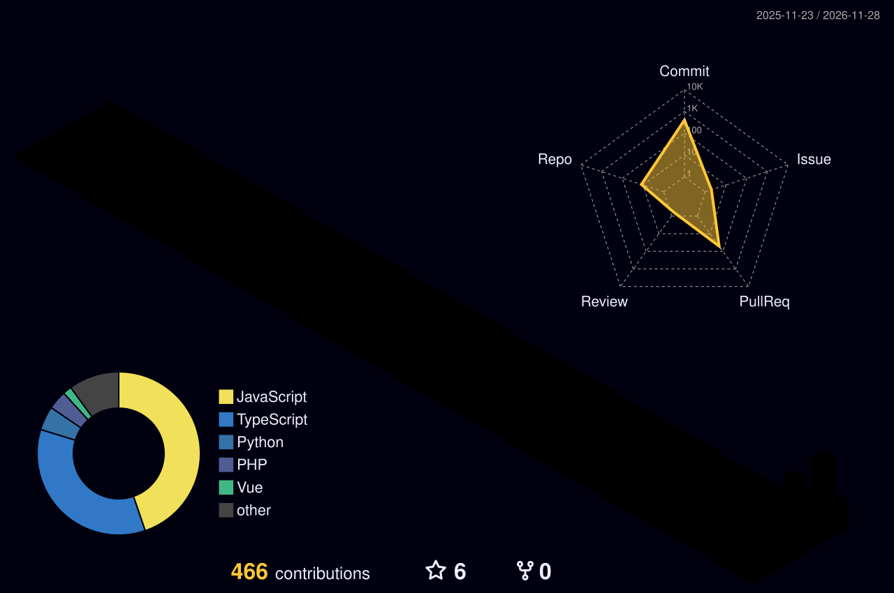

  <b>Information Systems Student · Web Developer · Open Source Enthusiast</b>

  
  

---

## 👨‍💻 About Me

I'm an Information Systems student at **Universitas Insan Pembangunan Indonesia** with an interest in building practical software, developer tools, and web applications.

I enjoy learning by building projects, exploring how systems work, and improving my skills through real development challenges.

- 🔭 Currently improving **React-Lara Forge**
- 🌱 Learning **JavaScript, Node.js, Laravel, React, and TypeScript**
- 🤝 Interested in open-source collaboration and constructive feedback
- 🎯 Goal: build useful, reliable tools and keep growing as a developer

---

## 🚀 Featured Project

### ⚙️ React-Lara Forge

**Generate a Laravel API + React SPA starter project in minutes.**

A Node.js CLI tool that scaffolds a Laravel backend and React frontend with a ready-to-customize application foundation.

- Laravel API + React SPA architecture
- Authentication starter and role-based access foundation
- JavaScript and TypeScript frontend options
- Database configuration options
- Cross-platform startup scripts

[Explore the repository →](https://github.com/Bagaas-ind/react-lara-forge)

---

## 🧰 Tech Stack & Tools

**Languages**

**Frameworks & Libraries**

**Databases & Developer Tools**

---

## 📊 GitHub Overview

  
  

  

---

## 🧊 3D Contribution Graph

  

---

## 💼 Experience

**PT ACS Wineto — Praktik Kerja Lapangan (PKL)**  
*Teknisi Jaringan / QC Modem / Sales*

- Assisted with Wi-Fi device installation and configuration at customer locations.
- Performed basic modem quality checks before installation.
- Helped troubleshoot basic network and modem issues.
- Explained internet service usage to customers.
- Supported the sales team in introducing internet services to prospective customers.

---

## 📫 Connect With Me

  
  

---

### 💬 Learning in public. Building with purpose.

*Thanks for visiting my profile. Feel free to explore my repositories, share feedback, or collaborate!*

